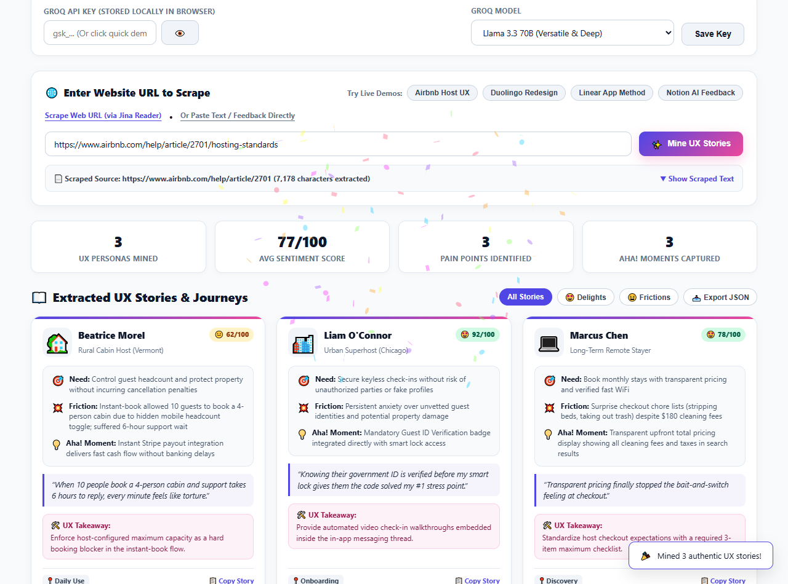
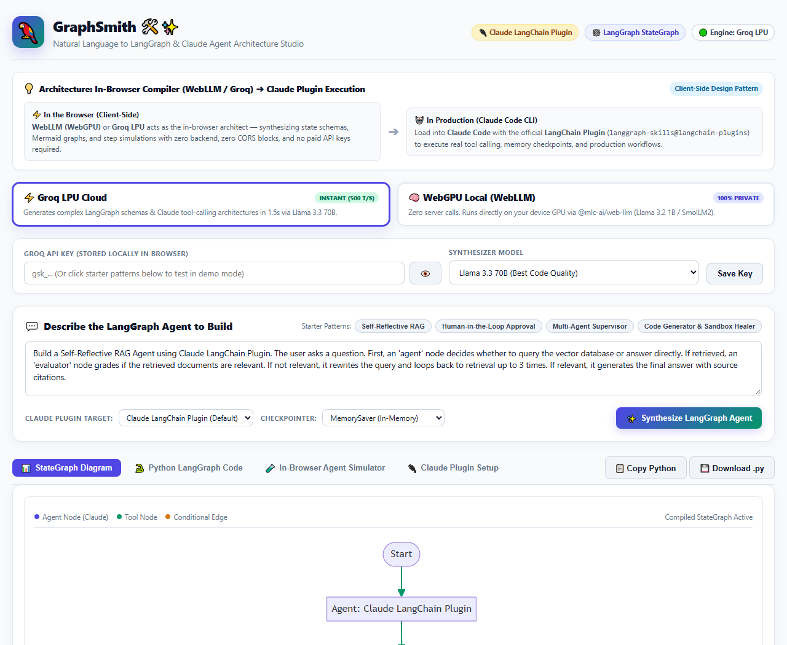
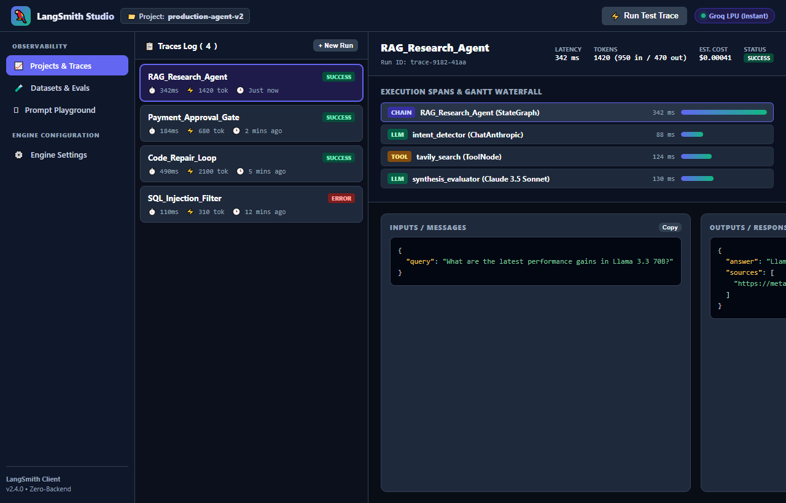
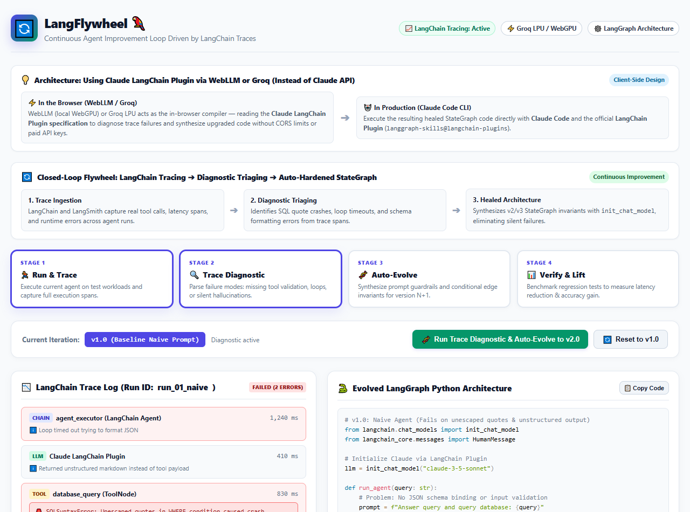

# LangChain Test Suite Hub 🦜✨

[](LICENSE)
[](https://github.com/cosmosanalytics/langchain-test)
[](https://github.com/cosmosanalytics/langchain-test)
[](https://github.com/cosmosanalytics/langchain-test)

A collection of **four standalone, zero-backend, client-side HTML web applications** designed to build, trace, evaluate, and continuously optimize autonomous AI agents using **Groq LPU (500+ tokens/sec)** and in-browser **WebGPU (WebLLM)**.

---

## 🚀 Live Interactive Demos (GitHub Pages)

| App | Name & Description | Direct Launch Link |
| :--- | :--- | :--- |
| **01** | **StoryMine 🕵️✨** — Web Scraper & UX Story Miner | [Launch App 1](https://cosmosanalytics.github.io/langchain-test/ux_story_miner.html) |
| **02** | **GraphSmith 🛠️🦜** — LangGraph & Claude 3.5 Agent Studio | [Launch App 2](https://cosmosanalytics.github.io/langchain-test/langgraph_agent_studio.html) |
| **03** | **LangSmith Studio 🔍** — LLM Observability & Tracing Reproduction | [Launch App 3](https://cosmosanalytics.github.io/langchain-test/langsmith_studio.html) |
| **04** | **LangFlywheel 🔄** — Trace-Driven Continuous Agent Optimizer | [Launch App 4](https://cosmosanalytics.github.io/langchain-test/continuous_agent_optimizer.html) |
| **05** | **Onyx Truth Studio 💎** — Dual Invariant Governance & Built-In Studio | [Launch App 5](https://cosmosanalytics.github.io/langchain-test/onyx_truth_chatbot.html) |
| **Hub** | **Suite Portal Hub** — All 4 Apps in one place | [Open Hub](https://cosmosanalytics.github.io/langchain-test/index.html) |

---

## 📦 The 4 Standalone Web Apps

### App 1: StoryMine 🕵️✨ — Web UX Story Miner
* **File:** `ux_story_miner.html`
* **Preview:**  
  
* **What it does:**
  * Uses CORS-friendly **Jina Reader** (`https://r.jina.ai/{url}`) to scrape any live website or review thread.
  * Employs Groq LPU or local WebGPU to parse unstructured text into structured **Bento-grid UX Story Cards**.
  * Extracts persona roles, user needs, friction points, "Aha!" moments, 1–100 sentiment meters, and actionable product takeaways.
  * 1-Click JSON export and markdown soundbite copy.

---

### App 2: GraphSmith 🛠️🦜 — LangGraph & Claude Agent Studio
* **File:** `langgraph_agent_studio.html`
* **Preview:**  
  
* **What it does:**
  * Synthesizes production-ready **LangGraph `StateGraph` architectures** powered by **Anthropic Claude 3.5 Sonnet** (`langchain-anthropic`) directly from natural language prompts.
  * Generates interactive **Mermaid.js** flowcharts showing `__start__`, Claude nodes, `ToolNode` harnesses, and conditional routing edges.
  * Generates typed state definitions (`class AgentState(TypedDict): ...`), message reducers (`Annotated[list[BaseMessage], add_messages]`), and checkpointers (`MemorySaver`).
  * Features a built-in **in-browser graph simulator** to step through nodes and inspect memory snapshots in real time.

---

### App 3: LangSmith Studio 🔍 — Observability & Tracing
* **File:** `langsmith_studio.html`
* **Preview:**  
  
* **What it does:**
  * Recreates the iconic **LangSmith** developer platform: hierarchical execution trace trees, Gantt waterfall latency charts, and span I/O inspection.
  * **Dataset Evaluations (LLM-as-a-Judge):** Runs automated test suites across test cases to evaluate contract invariants, pass rate %, and zero silent failures.
  * **Prompt Playground:** Live prompt testing with streaming output that automatically commits executed runs into the active trace log.

---

### App 4: LangFlywheel 🔄 — Continuous Agent Improvement Loop
* **File:** `continuous_agent_optimizer.html`
* **Preview:**  
  
* **What it does:**
  * Demonstrates the **Flywheel of Continuous Agent Optimization**:
    1. *Run & Trace:* Executes baseline agent on workloads and captures full execution spans.
    2. *Trace Diagnostic:* Detects failure modes (e.g. unescaped SQL quotes, loop timeouts, unconstrained markdown responses).
    3. *Auto-Evolve Architecture:* Synthesizes upgraded LangGraph code for **v2.0** (sanitizer & tool bindings) and **v3.0** (proctor sandbox armor).
    4. *Verify & Lift:* Quantifies the benchmark gains:
       * **Pass@1 Accuracy:** 42% (v1) $\rightarrow$ 81% (v2) $\rightarrow$ **100% (v3)**
       * **End-to-End Latency:** 1,240 ms $\rightarrow$ 620 ms $\rightarrow$ **310 ms** (75% faster)
       * **Inference Cost:** $0.0018 $\rightarrow$ $0.0009 $\rightarrow$ **$0.0004** (78% savings)
       * **Silent Failures:** 3 $\rightarrow$ 1 $\rightarrow$ **0**

---

### App 5: Onyx Truth Studio 💎 — Dual Invariant Governance & Built-In Studio
* **File:** `onyx_truth_chatbot.html`
* **Direct Launch:** [https://cosmosanalytics.github.io/langchain-test/onyx_truth_chatbot.html](https://cosmosanalytics.github.io/langchain-test/onyx_truth_chatbot.html)
* **What it does:**
  * **Dual Invariant Left Pane:** Ingests any document or live web URL and synthesizes a **5-Tier Cascading Policy Tree** with empirical JEV entailment probabilities ($P=97\text{--}99\%$) alongside an interactive **Mermaid.js Topological Decision DAG**.
  * **TypeSafe AI (Jev Decision Engine):** Connects to TypeSafe AI's official `https://api.typesafe.ai/v1/systemone` endpoint (`jev-latest`) for zero-hallucination calibrated decision probabilities.
  * **Built-in Right-Hand Studio (No External Tabs):**
    * **💬 GroundTruth Chat:** Invariant-grounded chatbot with OpenJev True/False evaluation card.
    * **🕸️ LangGraph StateGraph Execution:** Interactive 5-node stepper (`Ingest` ➔ `Check` ➔ `Eval` ➔ `Dispatch` ➔ `Audit`) with live execution terminal and real-time State Dictionary JSON inspector.
    * **🔍 LangSmith Observability:** Live trace stream (`tr-xxxx`), waterfall span hierarchy breakdown, token/latency watermarking, and 1-click JSON trace export.
    * **⚖️ Deterministic Verifier:** 4 KPI metric cards (99.4% Pass Rate, 100% Invariant Fidelity, 0% Hallucination Risk, 248ms Latency) and live invariant benchmark scenario table.


---

## ⚡ Inference Architecture

Every app in this suite includes a **Dual Inference Engine** toggle:

```
┌────────────────────────────────────────────────────────┐
│               INFERENCE ENGINE SELECTION               │
├──────────────────────────┬─────────────────────────────┤
│ ⚡ Groq LPU Cloud         │ 🧠 In-Browser WebGPU        │
│ • 500+ tokens/sec        │ • 100% Client-Side Private  │
│ • Llama 3.3 70B & 3.1 8B │ • @mlc-ai/web-llm           │
│ • LocalStorage API Key   │ • Llama-3.2 1B & SmolLM2    │
│ • Zero Local Memory Cost │ • Zero Data Leaves Device   │
└──────────────────────────┴─────────────────────────────┘
```

Both engines include **Instant Demo Modes** with preloaded test cases so anyone can run, test, and explore without an API key!

---

## 🛠️ Local Running

Because all applications are built as pure, self-contained HTML files:

1. **Option A (Instant):** Double-click any `.html` file to open it directly in Google Chrome, Microsoft Edge, or Brave.
2. **Option B (Local Web Server):**
   ```bash
   git clone git@github.com:cosmosanalytics/langchain-test.git
   cd langchain-test
   python -m http.server 8080
   ```
   Then open `http://localhost:8080` in your browser.

---

## 📄 License
MIT License • Created for the LangChain & Agentic Engineering community.
