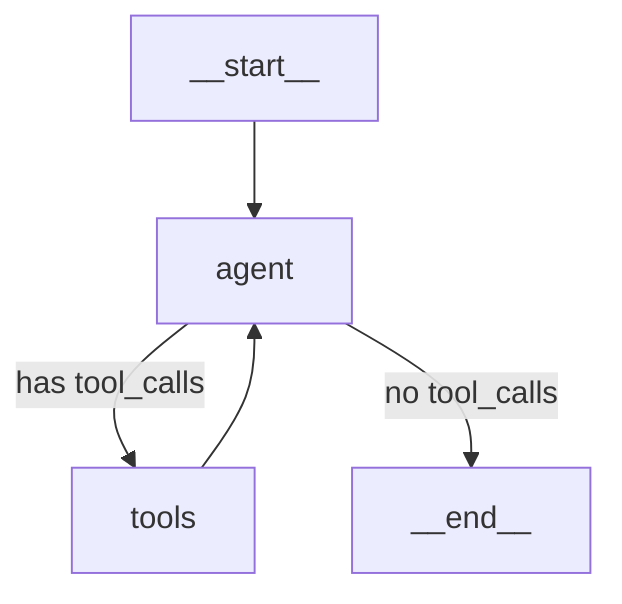

# Agent Tutorial: LangChain → LangGraph → LangSmith

A small tutor agent that answers questions about these three libraries. It uses a
calculator and a glossary as tools, remembers earlier turns in a conversation, and
is traced and evaluated in LangSmith. Each lesson is one runnable file. Read the
code top to bottom, then run it.

| Lesson | File | You learn |
| --- | --- | --- |
| 1 | `lesson1_langchain.py` | Chat models, prompt templates, LCEL (`\|`), structured output, tools |
| 2 | `lesson2_langgraph.py` | State, nodes, edges, the agent loop, `ToolNode`, memory via checkpointer |
| 3 | `lesson3_langsmith.py` | Automatic tracing, `@traceable`, datasets, evaluators, experiments |

## How the three fit together

```
LangChain   = the building blocks   (model, prompt, tool, parser)
LangGraph   = the control flow      (loop: model -> tools -> model ... -> answer)
LangSmith   = the observability     (see every step, measure quality over a dataset)
```

The agent graph built in lesson 2:



## Setup (5 minutes)

```bash
cd agent-tutorial
python -m venv .venv && source .venv/bin/activate   # Python 3.10+
pip install -r requirements.txt
cp .env.example .env    # then put your GROQ_API_KEY and LANGSMITH_API_KEY in .env
```

`.env.example` already points at the AWS-hosted LangSmith instance
(`https://aws.api.smith.langchain.com`) and the AIDA workspace. To use another
provider, change `MODEL` (e.g. `openai:gpt-4o-mini`) and `pip install langchain-openai`.

## Lesson 1: LangChain basics

```bash
python lesson1_langchain.py
```

- **Chat model**: `init_chat_model("groq:openai/gpt-oss-120b")` gives one interface for every provider. `.invoke(messages)` returns an `AIMessage`.
- **Prompt template**: `ChatPromptTemplate` fills in `{variables}` and produces messages.
- **LCEL**: `prompt | model | StrOutputParser()` is a `Runnable`. Every runnable has `invoke`, `batch` and `stream`.
- **Structured output**: `model.with_structured_output(PydanticClass)` returns a validated object instead of text.
- **Tools**: `@tool` turns a function into a schema built from its docstring and type hints. `bind_tools` lets the model *request* calls (`ai_msg.tool_calls`). The model never runs the tool itself; your code does.

Try: add your own `@tool` and ask a question that needs it.

## Lesson 2: a LangGraph agent

```bash
python lesson2_langgraph.py
```

- **State** (`State` TypedDict): the shared data. The `add_messages` reducer appends messages instead of replacing them.
- **Nodes**: `agent` calls the model; `tools` (`ToolNode`) runs the requested tools.
- **Edges**: `tools_condition` routes to `tools` when the model asked for one, otherwise to the end. The edge from `tools` back to `agent` creates the loop.
- **Memory**: `compile(checkpointer=InMemorySaver())` plus a `thread_id` in `config`. The same thread remembers earlier turns; a new thread starts fresh.
- **Streaming**: `app.stream(..., stream_mode="updates")` shows each step of the loop as it happens.

The same agent in one line, using the prebuilt helper (good for production, less instructive):

```python
from langchain.agents import create_agent
app = create_agent("groq:openai/gpt-oss-120b", tools=TOOLS, system_prompt=SYSTEM_PROMPT)
```

Try: add a `max_steps` counter to `State`, or swap `InMemorySaver` for `SqliteSaver` to keep memory after the script exits.

## Lesson 3: LangSmith tracing and evaluation

```bash
python lesson3_langsmith.py
```

1. **Tracing**: setting `LANGSMITH_TRACING=true` is the only code change needed. Open https://aws.smith.langchain.com → *Tracing Projects* → `agent-tutorial`. Click a run to see the trace tree (`tutor_agent` → `agent` → `tools` → `agent`), with inputs, outputs, latency and tokens at each step.
2. **`@traceable`**: wraps any Python function so it appears as a span. Here, `run_agent` is the parent span.
3. **Dataset**: the script creates `agent-tutorial-qa` with 5 question/reference pairs. View it under *Datasets & Experiments*.
4. **Evaluators**: these are plain functions `(outputs, reference_outputs) -> {"key", "score"}`. `correct_answer` checks the answer and `used_right_tool` checks the tool call.
5. **Experiment**: `evaluate(target, data=..., evaluators=[...])` runs the agent on every example and uploads the scores. Change the prompt or model, run it again, and use *Compare* in the UI to compare the two experiments.

Try: add an LLM-as-judge evaluator that asks the model whether the answer is helpful.

## Next steps

- `langgraph dev` (LangGraph Studio) to visualise and step through the graph in a browser.
- Human-in-the-loop: `interrupt_before=["tools"]` to approve tool calls.
- Prompt Hub: push `SYSTEM_PROMPT` to LangSmith and pull it at runtime.
